# Multi-Protocol (HTTP/1.1, HTTP/2, HTTP/3) RESTful API with Hypercorn and Starlette

Python 비동기 ASGI 서버인 `Hypercorn`과 경량 웹 프레임워크인 `Starlette`을 활용하여 구현한 **멀티 프로토콜(HTTP/1.1, HTTP/2, HTTP/3) 지원 RESTful API 애플리케이션**입니다.

이전 단계에서 표준 라이브러리(`http.server`)로 직접 구현했던 저수준 HTTP/1.1 서버를 현대적인 **ASGI(Asynchronous Server Gateway Interface)** 아키텍처로 고도화하였으며, 단일 애플리케이션 코드(`server_app.py`)를 수정하지 않고도 전송 계층 및 프로토콜 설정에 따라 평문 `HTTP/1.1`과 TLS 암호화 기반 `HTTP/2(h2)`, QUIC 기반 `HTTP/3(h3)` 통신을 모두 처리할 수 있는 구조를 검증했습니다.

---

## Tech Stack

| 구분 | 기술 스택 | 설명 |
| :--- | :--- | :--- |
| **ASGI Server** | `Hypercorn` | HTTP/1.1, HTTP/2(TLS), HTTP/3(QUIC) 멀티 프로토콜 비동기 서버 엔진 |
| **Web Framework** | `Starlette`, `Jinja2` | 비동기 라우팅, JSON 파싱, CORS 미들웨어 및 HTML/PyScript 템플릿 서빙 |
| **Frontend Client** | HTML5, Pico.css, PyScript | 프로토콜 버전 선택 UI 및 브라우저 내 Python(`client_main.py`) 비동기 실행 |
| **HTTP Client** | Axios (via PyScript JS FFI) | 선택된 프로토콜 엔드포인트로 비동기 CRUD 요청(`POST`, `GET`, `PUT`, `DELETE`) 전송 |
| **Security / TLS** | X.509 Self-Signed Certificate | 로컬 `HTTP/2` 및 `HTTP/3` 통신을 위한 자체 서명 인증서(`localhost.crt`, `localhost.key`) |
| **Packaging** | Poetry | 프로젝트 가상환경 및 의존성 패키지(`pyproject.toml`, `poetry.lock`) 관리 |

---

## System Architecture


### 핵심 설계 및 아키텍처 특징
1. **프로토콜 처리 계층(Hypercorn)과 비즈니스 로직(Starlette)의 분리**
   * 네트워크 연결 관리 및 HTTP 버전별 프레이밍(HTTP/1.1 텍스트 파싱, HTTP/2 바이너리 멀티플렉싱, HTTP/3 QUIC 스트림)은 앞단의 `Hypercorn` ASGI 서버가 전담합니다.
   * 뒷단의 `Starlette` 애플리케이션(`server_app.py`)은 표준화된 ASGI 인터페이스(`scope`, `receive`, `send`)를 통해 프로토콜 버전에 구애받지 않고 동일한 비동기 핸들러(`do_POST`, `do_GET`, `do_PUT`, `do_DELETE`)로 CRUD 로직을 수행합니다.
2. **단일 서버를 통한 템플릿 및 API 통합 서빙**
   * 정적 웹 서버(`8000`)와 API 서버(`8080`)를 별도 프로세스로 분리했던 이전 구조와 달리, `Jinja2Templates`와 `Route` 설정을 통해 단일 서버에서 클라이언트 HTML/PyScript 파일 서빙과 `/membership_api/{key}` REST API 처리를 통합했습니다.
3. **고수준 추상화를 통한 보일러플레이트 제거**
   * 수동으로 처리하던 `Content-Length` 바이트 읽기, URL 문자열 파싱(`split('/')`), CORS 응답 헤더 작성을 각각 `await request.json()`, `request.path_params["key"]`, `CORSMiddleware`로 대체하여 코드 가독성과 안정성을 높였습니다.

---

## Execution Screenshots

### 1. HTTP/1.1 모드 동작 검증 (`http://127.0.0.1:8000`)

#### (1) HTTP/1.1 클라이언트 UI
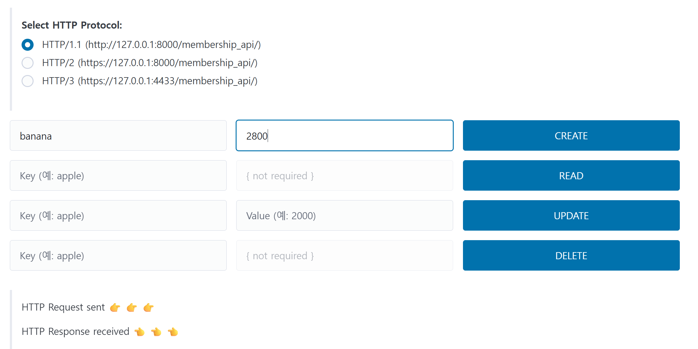

#### (2) HTTP/1.1 CRUD 실행 결과 (`apple` 데이터 생명주기)

| 1. CREATE (`POST`) | 2. READ (`GET`) |
| :---: | :---: |
| 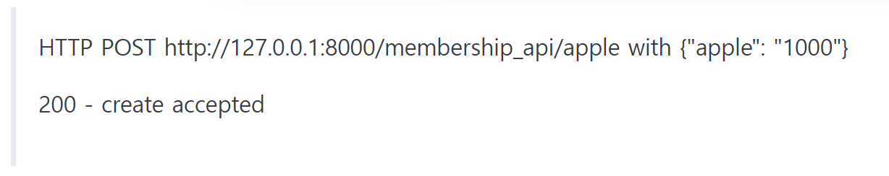 | 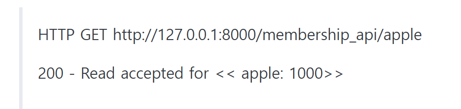 |
| **3. UPDATE (`PUT`)** | **4. DELETE (`DELETE`)** |
| 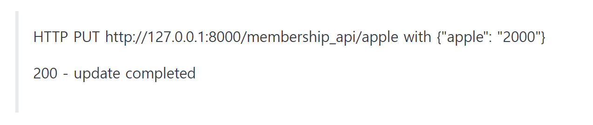 | 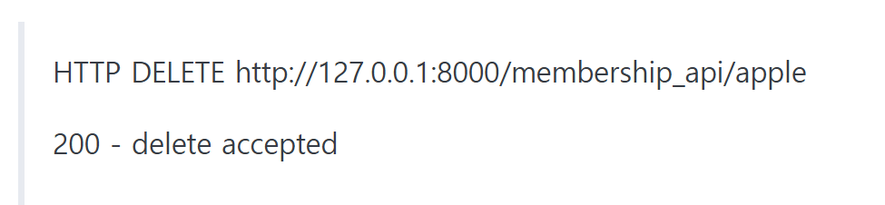 |

---

### 2. HTTP/2 (HTTPS) 모드 동작 검증 (`https://127.0.0.1:8000`)

#### (1) HTTP/2 클라이언트 UI
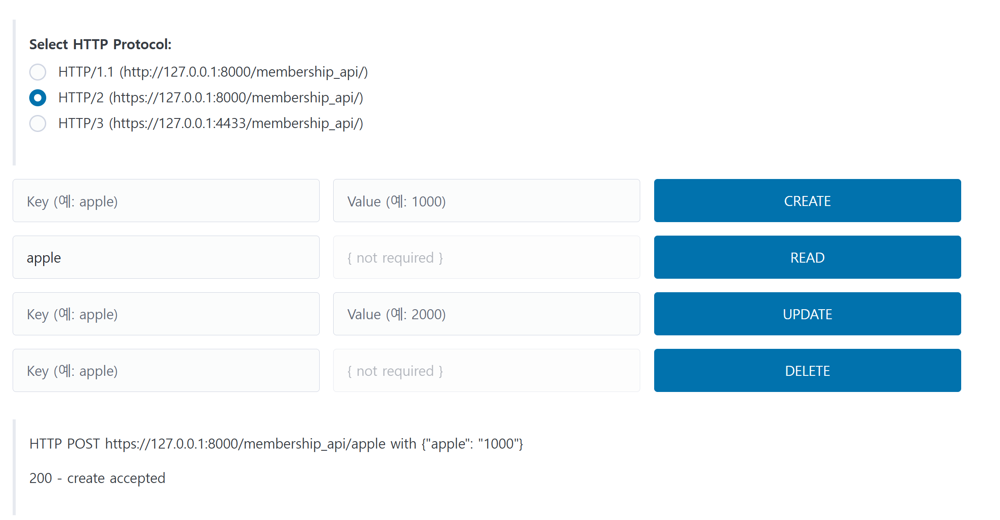

#### (2) HTTP/2 CRUD 실행 결과 (`apple` 데이터 생명주기)

| 1. CREATE (`POST`) | 2. READ (`GET`) |
| :---: | :---: |
| 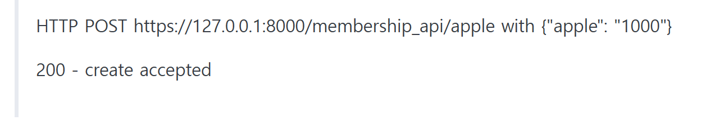 | 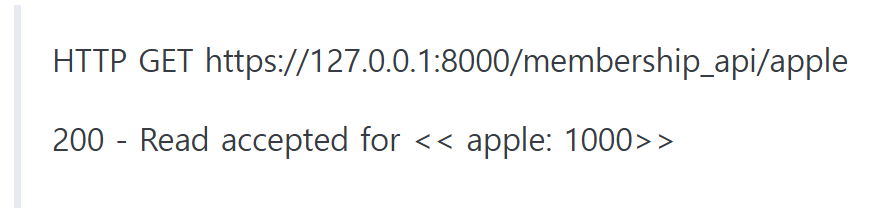 |
| **3. UPDATE (`PUT`)** | **4. DELETE (`DELETE`)** |
| 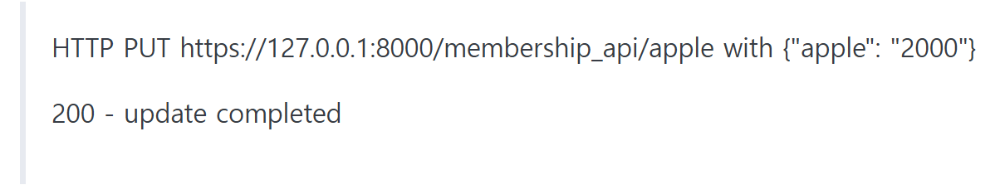 | 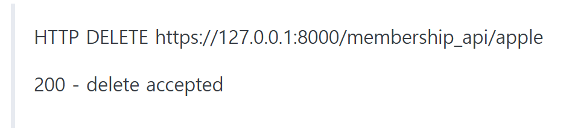 |

---

### 3. 서버 터미널 로그

| HTTP/1.1 Server Log | HTTP/2 Server Log |
| :---: | :---: |
| 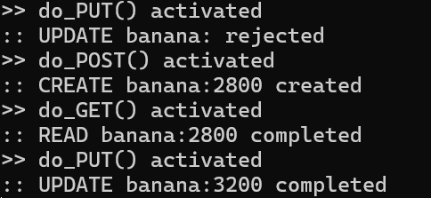 | 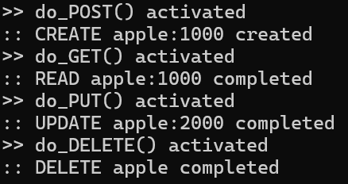 |

---

## Getting Started

### 1. 저장소 클론 및 패키지 설치
```bash
git clone https://github.com/monolail/http123.git
cd http123
python -m poetry install
```

### 2. 서버 실행 (모드별 선택 실행)
먼저 `src` 디렉토리로 이동한 뒤 원하는 프로토콜 모드로 서버를 실행합니다.
```bash
cd src
```

* **Mode 1: HTTP/1.1 (평문 통신)**
  ```bash
  python -m poetry run hypercorn server_app:run --bind 127.0.0.1:8000
  ```
  * 접속 URL: `http://127.0.0.1:8000/`

* **Mode 2: HTTP/2 (TLS 암호화 통신)**
  ```bash
  python -m poetry run hypercorn --certfile cert/localhost.crt --keyfile cert/localhost.key --bind 127.0.0.1:8000 server_app:run
  ```
  * 접속 URL: `https://127.0.0.1:8000/`

* **Mode 3: HTTP/2 & HTTP/3 동시 활성화 (QUIC 바인딩 포함)**
  ```bash
  python -m poetry run hypercorn --quic-bind 127.0.0.1:4433 --certfile cert/localhost.crt --keyfile cert/localhost.key --bind 127.0.0.1:8000 server_app:run
  ```

---

## Project Structure

```text
http123/
├── src/
│   ├── server_app.py               # Starlette 기반 비동기 REST API 및 템플릿 서빙 애플리케이션
│   ├── cert/
│   │   ├── localhost.crt           # 로컬 HTTPS(HTTP/2, HTTP/3) 통신용 자체 서명 인증서
│   │   └── localhost.key           # 인증서 개인키
│   ├── htdocs/
│   │   └── robots.txt              # 정적 파일 디렉토리
│   └── templates/
│       ├── client_pyscript.html    # 프로토콜 선택 라디오 버튼 및 CRUD 웹 UI
│       └── client_main.py          # 프로토콜별 엔드포인트 분기 및 비동기 요청 스크립트
├── screen/                         # HTTP/1.1 및 HTTP/2 실행 결과 스크린샷
├── pyproject.toml                  # Poetry 의존성 설정 파일
├── poetry.lock                     # 패키지 버전 잠금 파일
└── README.md                       # 프로젝트 문서
```
